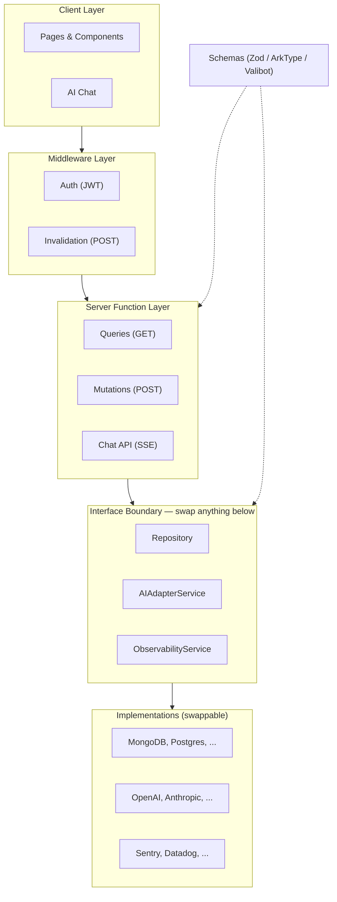

# TanStack AI-Promptable Full-Stack Template

Opinionated [TanStack Start](https://tanstack.com/start) starter for **AI-promptable** apps: one schema → repository → server-function path powers both the UI and the AI tools. External services sit behind interfaces (DB, AI, observability). Seed data means `pnpm dev` works with zero config.

**[Live Demo — side](https://fullstack-promptable-app-example.netlify.app)** · **[Live Demo — prompt-first](https://fullstack-promptable-prompt-first.netlify.app)** · **[Live Demo — agentic](https://fullstack-promptable-agentic.netlify.app)** · **[Blog](building-ai-promptable-fullstack-apps.md)**

## Why this exists

Most full-stack apps rebuild the same foundation every time — auth, data access, UI shell, observability, and AI plumbing — before any product code lands. This template freezes those decisions so you ship domain features from day one, without rewriting when you leave the prototype stage.

## What you get

- **Prototype → MVP without rewrites** — start on the in-memory seed repository; flip to MongoDB (or another `Repository`) via env. Same interfaces, routes, and AI tools.
- **One code path for UI + AI** — tools call the same server functions as loaders and forms, so auth, validation, and errors stay consistent.
- **Solid boundaries** — schemas as source of truth; repository / AI / observability interfaces; URL-as-state and loaders-first for scalable, bookmarkable UI.
- **Agent-ready** — published [Agent Skills](https://agentskills.io) encode the architecture contract so scaffolding and refactors stay aligned.

## Three UX modes, one codebase

Pick one experience per deployment (`PROMPT_CONCEPT`). Same schemas, repositories, and tools underneath.

| Mode | Best for | What the user sees | Demo |
|------|----------|--------------------|------|
| **side** (default) | Product apps with domain screens | Routes + header; AI chat in a right drawer until opened | [side](https://fullstack-promptable-app-example.netlify.app) |
| **prompt-first** | Conversation-led workflows | Bottom prompt bar and conversation stage, same domain routes | [prompt-first](https://fullstack-promptable-prompt-first.netlify.app) |
| **agentic** | Tool-only / agent shells | Thin shell; views rendered from tool / A2UI data — no hand-built domain screens | [agentic](https://fullstack-promptable-agentic.netlify.app) |

Multi-site Netlify wiring: [Deploy demos](#deploy-demos).

## Opinionated stack

Defaults for the reference app — swappable at the [interface boundary](#swappable-layers).

| Concern | Default |
|---------|---------|
| Framework / routing / AI | [TanStack Start](https://tanstack.com/start) · [Router](https://tanstack.com/router) · [AI](https://tanstack.com/ai) |
| UI | [Mantine](https://mantine.dev/) |
| Validation | [Zod](https://zod.dev/) |
| Data | [MongoDB](https://www.mongodb.com/) + in-memory seed |
| Auth | [jose](https://github.com/panva/jose) (JWT header) |
| Observability | [Sentry](https://sentry.io/) + pino (optional / no-op) |
| Test / lint | [Vitest](https://vitest.dev/) · [Playwright](https://playwright.dev/) · [Biome](https://biomejs.dev/) |
| Deploy | [Netlify](https://www.netlify.com/) (Nitro SSR) |

## Path to production

1. `pnpm install && pnpm dev` — seed data, no DB or API keys required.
2. Define domain schemas and the entity end-to-end (repository → server functions → routes).
3. Expose the same server functions as AI tools.
4. For a durable deploy: set `MONGODB_URI` and leave `REPOSITORY_TYPE` unset (or `mongo` — an explicit `seed` overrides the URI); set `AUTH_JWT_SECRET` or `AUTH_JWKS_URL` (+ `AUTH_JWT_ISSUER`) so signed `Authorization` headers are trusted; add an AI provider key; optionally `SENTRY_DSN`. Without a JWT verifier, header identity is ignored and the demo cookie remains.

Details: [Extending the Template](#extending-the-template) · [Using This Template](#using-this-template).

## Quick start

```bash
pnpm install
pnpm dev
```

Open [http://localhost:3000](http://localhost:3000). Docker: `docker build -t my-app . && docker run --rm -p 3000:3000 my-app`.

## Use the Agent Skill

This repo publishes skills under `.agents/skills/*/SKILL.md`. Install into your coding agent:

```bash
npx skills add carlosvin/tanstack-fullstack-ai-template
```

Install details, per-skill roles, and other install paths: **[skills/README.md](./skills/README.md)**. Ops handbook: **[AGENTS.md](./AGENTS.md)**. Architecture contract: the `tanstack-promptable-fullstack-app-template` skill.

**Ask your agent:**

- "What are the core contract items in the TanStack fullstack skill I must not violate?"
- "Add a new domain entity following this template’s schema layers, repository, server functions, routes, and AI tools."
- "Should any of my nested routes move shared `beforeLoad` or loader work to a parent layout?"

**What the skill enforces:** one tools-layer schema for UI and AI; thin routes with loaders and URL search state; POST mutations with auth + invalidation; repository capabilities as tools plus client `navigate` / `invalidateRouter`; parent layouts own shared work; preserve TypeScript inference after parse.

## Architecture

Layers with clear interface boundaries — the interfaces are the contract; implementations are your choice.



### Swappable Layers

| Layer | Interface | Default | Alternatives |
|-------|-----------|---------|-------------|
| **Database** | `Repository` | [MongoDB](https://www.mongodb.com/) | [Postgres](https://www.postgresql.org/), [DynamoDB](https://aws.amazon.com/dynamodb/), [Supabase](https://supabase.com/), in-memory |
| **AI Provider** | `AIAdapterService` | Gemini → OpenAI / Gateway → Azure | [Anthropic](https://www.anthropic.com/), [Ollama](https://ollama.com/), any OpenAI-compatible |
| **Observability** | `ObservabilityService` | [Sentry](https://sentry.io/) | [Datadog](https://www.datadoghq.com/), [OpenTelemetry](https://opentelemetry.io/), no-op |
| **UI Library** | — (component layer) | [Mantine](https://mantine.dev/) | [shadcn/ui](https://ui.shadcn.com/), [Chakra](https://chakra-ui.com/), [Ant Design](https://ant.design/), [Radix](https://www.radix-ui.com/) |
| **Schema Validation** | — ([Standard Schema](https://github.com/standard-schema/standard-schema)) | [Zod](https://zod.dev/) | [ArkType](https://arktype.io/), [Valibot](https://valibot.dev/), [Effect Schema](https://effect.website/docs/schema/introduction/) |

Zod is the default for ecosystem reach; any Standard Schema library works at the same boundaries. Zod v4 field metadata (formatting, units) helps both UI and AI tool hints.

### Key Design Decisions

- **Repository pattern** — all data access through an interface; seed for local, Mongo (or other) via env.
- **Auth + invalidation middleware** — JWT → typed access ticket; POST mutations chain `requireAuthMiddleware` and `invalidateMiddleware` so the client refreshes without manual `router.invalidate()`.
- **Promptable by default** — AI tools wrap the same server functions via `createSafeServerTool()`; client tools (`navigate`, `invalidateRouter`) run in the browser; optional MCP at `/api/mcp`.
- **URL-aware AI** — chat sends browser location so “this task” resolves to the page in view.
- **Schemas = source of truth** — `.describe()` metadata; types inferred; JSON Schema flows to tools.
- **URL-as-state + loaders-first** — filters/selections in search params; data in route loaders (caching, SSR, no `useEffect` fetch).
- **Observability as a plugin** — no DSN → no-op; swap the `ObservabilityService` implementation when needed.

## Project Structure

```
src/
├── start.ts                    # Global middleware registration
├── router.tsx                  # Router + client observability
├── middleware/
│   ├── auth.ts                 # JWT → AuthContext
│   ├── requireAuth.ts          # Function middleware for mutations (401 if not logged in)
│   └── invalidate.ts           # POST → router.invalidate()
├── routes/                     # File-based routes (pages)
├── components/                 # React components
├── services/
│   ├── schemas/schemas.ts      # Zod schemas (single source of truth)
│   ├── repository/             # Interface + Seed + Mongo implementations
│   ├── api/serverFns.ts        # Server functions (TanStack Start)
│   ├── ai/
│   │   ├── types.ts            # AIAdapterService interface
│   │   ├── adapter.ts          # Provider implementation + factory
│   │   └── tools.ts            # AI tool definitions
│   ├── observability/
│   │   ├── types.ts            # ObservabilityService interface
│   │   ├── sentry.ts           # Sentry implementation
│   │   ├── noop.ts             # No-op implementation
│   │   └── getObservability.ts # Factory
│   └── db/mongoClient.server.ts # MongoDB singleton (server-only)
├── utils/
│   ├── auth.ts                 # requireAuth(), requireGroup()
│   ├── httpError.ts            # HttpError class
│   └── jwt.ts                  # JWT decode
├── constants/                  # Shared enums
└── test-utils/                 # Vitest helpers

e2e/                               # Playwright E2E tests (seed + JWT fixtures)
```

## Environment Variables

See [`.env.example`](.env.example) for the full list.

| Variable | Required | Default | Description |
|----------|----------|---------|-------------|
| `MONGODB_URI` | No | — | MongoDB connection string. If absent, seed repo is used. |
| `MONGODB_DB_NAME` | No | `app-db` | Database name. |
| `REPOSITORY_TYPE` | No | auto | `seed` or `mongo`. Auto-detected from `MONGODB_URI`. |
| `PROMPT_CONCEPT` | No | `side` | UX shell: `side`, `prompt-first`, or `agentic`. |
| `GEMINI_API_KEY` / `OPENAI_API_KEY` / `AZURE_OPENAI_*` | No | — | First configured provider wins (Gemini → OpenAI/Gateway → Azure). Chat disabled without one. |
| `SENTRY_DSN` | No | — | Observability disabled without it. |
| `AUTH_JWT_SECRET` / `AUTH_JWKS_URL` | No* | — | Verifier for signed bearer JWTs (`exp` required; JWKS needs `AUTH_JWT_ISSUER`). Without one, header identity is ignored. |
| `AUTH_HEADER_NAME` | No | `Authorization` | HTTP header containing the JWT. |

* Required for production identity — set a verifier before trusting caller headers. Demo Netlify sites may keep `REPOSITORY_TYPE=seed`; real apps should use Mongo as above.

## Extending the Template

### Adding a New Entity (End-to-End)

1. **Schema**: Add Zod schemas in `src/services/schemas/schemas.ts` with `.describe()` on every field.
2. **Repository**: Add methods to the `Repository` interface in `types.ts`. Implement them in `seedRepository.ts` and in the owning Mongo collection repository. Delegate from `mongoRepository.server.ts`. Declare indexes in that collection owner’s `createIndexes()`.
3. **Server Functions**: Add `createServerFn` wrappers in `src/services/api/serverFns.ts`. Chain `.middleware([invalidateMiddleware])` on mutations.
4. **AI Tools**: Expose methods as tools in `src/services/ai/tools.ts` via `createSafeServerTool()`. Keep `navigationManifest.ts` aligned with routes; send `browserContext` from the chat client.
5. **Routes**: Create route files under `src/routes/`. Use loaders to fetch data.
6. **Tests**: Unit-test the seed repository; add E2E coverage in `e2e/` for new routes.

### Swapping layers

- **Database** — implement `Repository`, construct it in `ensureRepository()`, inject via `repositoryMiddleware`.
- **AI** — implement `AIAdapterService` in `src/services/ai/types.ts`; update the factory in `adapter.ts`.
- **Observability** — implement `ObservabilityService`; update `getObservability.ts` and `instrument.server.mts`.
- **UI** — replace Mantine imports; repository / server functions / middleware stay unchanged.

## Scripts

```bash
pnpm dev           # Dev server on port 3000
pnpm build         # Production build
pnpm start         # Run production server
pnpm test          # Unit tests (Vitest)
pnpm test:e2e      # E2E tests (Playwright, seed data)
pnpm lint          # Lint + typecheck (Biome)
pnpm format        # Auto-format (Biome)
pnpm skills:check  # Companion reciprocity + install commands
pnpm skills:waza   # Waza skill readiness + mock evals
```

## Using This Template

### Option A: Clone and Build (New Project)

```bash
git clone https://github.com/carlosvin/tanstack-fullstack-ai-template.git my-app
cd my-app
rm -rf .git && git init
pnpm install
pnpm dev
```

Then follow [Path to production](#path-to-production) and [Adding a New Entity](#adding-a-new-entity-end-to-end).

### Option B: AI-assisted (skill)

See [Use the Agent Skill](#use-the-agent-skill). Contributor workflow: **[skills/AUTHORING.md](./skills/AUTHORING.md)**.

### Option C: Adopt Incrementally (Existing Project)

Each layer is independently valuable:

1. Schema layer with `.describe()` metadata
2. `Repository` interface for data access
3. Server functions + `processResponse()`
4. Auth middleware + typed access ticket
5. `ObservabilityService`
6. AI tools over the same server functions
7. Loaders + URL search params instead of `useEffect` / local page state

### Deploy demos

One codebase, three Netlify sites — set `PROMPT_CONCEPT` and a distinct `DISPLAY_NAME` per site (`side` / `prompt-first` / `agentic`). Same build as `netlify.toml`. Helper scripts: `scripts/netlify/setup-prompt-first-site.sh`, `scripts/netlify/setup-agentic-site.sh`. Enable **Deploy Previews** and disable **Branch deploys** so each PR gets one preview URL per UX mode.

These demo sites may use `REPOSITORY_TYPE=seed` for zero-ops previews. For a production app on Netlify, follow [Path to production](#path-to-production): Mongo (`MONGODB_URI`, not `seed`) plus a JWT verifier.

## License

MIT
